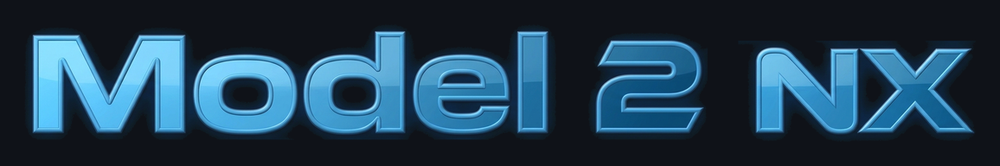

  

# Model2-NX

A Nintendo Switch homebrew port (`.nro`) of
[Model2EmuEx](https://github.com/octavioCuatrochio/Model2EmuEx) by octavioCuatrochio:
a portable C port of ElSemi's Sega Model 2 Emulator 1.1a, rebuilt from a Ghidra
decompilation. This port is based on its `coop` branch (separate emulation,
sound and drawing threads, the launcher, and two-player linked Daytona USA).

> **Experimental / in development.** Built and linked with devkitA64, not yet
> verified on every game or on every console setup.

## Games

| Game | Set | Status upstream |
|------|-----|-----------------|
| Daytona USA | `daytona` | playable: races, sound, controls, gears, linked 2-player |
| Virtua Fighter 2 | `vf2` | boots and runs attract mode with 2D, 3D and sound |
| Sega Rally Championship | `srallyc` | boots and runs attract mode with 2D, 3D and sound |

Other Model 2 / 2A games in the list may boot but haven't been tried. Model 2B
(SHARC) games are not emulated.

## Installation

1. Copy `Model2-NX.nro` to `sdmc:/switch/Model2-NX/` on the SD card.
2. Put the MAME-style ROM zips (`daytona.zip`, `vf2.zip`, `srallyc.zip`, and
   `model2.zip` if your sets need it) in `sdmc:/switch/Model2-NX/roms/`.
3. Launch it from the Homebrew Menu. Use title takeover (hold R while opening a
   game) rather than the album applet, so the emulator gets all the memory.

The folders are created on the first run if they're missing.

| Path | Contents |
|------|----------|
| `sdmc:/switch/Model2-NX/roms/` | ROM zips |
| `sdmc:/switch/Model2-NX/NVDATA/` | save data (`<game>.DAT`, same format as the PC emulator's) |
| `sdmc:/switch/Model2-NX/m2emu.ini` | settings, written by the launcher |
| `sdmc:/switch/Model2-NX/Covers/` | optional game covers (`<set>.png` / `.jpg`) |
| `sdmc:/switch/Model2-NX/gamecontrollerdb.txt` | optional extra pad mappings |

## Menu

The menu works like SuperModel NX's: the logo on top, the list of games on the
left and the cover of the game under the cursor on the right.

| Button | Action |
|--------|--------|
| D-pad / left stick | move |
| A | start the game under the cursor |
| + | settings (and back to the game list) |
| B | back |
| HOME | close the program |
| Touch screen | works as a mouse |

The settings have five tabs:

- **General**: FPS on screen, only show the games found in the ROMs folder,
  Daytona USA linked play (split screen) and its layout, Load Defaults.
- **Core**: pipeline (emulation on its own core), frame limiter, VSync.
- **Video**: resolution, widescreen, texture filter, scaling filter, shadows and
  fences, linked-play picture shape, saturation, gamma.
- **Audio**: volume.
- **Credits**.

Settings are saved to `m2emu.ini` as you change them.

### Covers

Put your own covers in `sdmc:/switch/Model2-NX/Covers/`, named after the ROM set:
`daytona.png`, `vf2.jpg`, `srallyc.png`... (PNG or JPEG). A clone without a
cover of its own shows its parent's. None are included.

## In game

| Button | Driving games (Daytona USA, Sega Rally...) | Virtua Fighter 2 |
|--------|--------------------------|------------------|
| Left stick | steer | move |
| A / ZR | accelerate | — |
| B / ZL | brake | — |
| D-pad | view buttons: ↑ VR1, → VR2, ↓ VR3, ← VR4 (Sega Rally: any direction) | move |
| R / L | gear up / down | — |
| A B X Y | — (A and B are the pedals) | buttons 1–4 (guard, punch, kick) |
| + | start | start |
| − | coin | coin |
| L3 / R3 (stick click) | service / test | service / test |
| **− and + together** | **pause menu** | **pause menu** |

The pause menu stops the game and offers **Reset**, **Exit** (back to the game
list) and **Cancel**.

Linked play (Daytona USA) needs two controllers: the first one drives player 1
(left or top half), the second one player 2.

## What the Switch port changes

The emulation core (i960, TGP, 68000 sound board, SCSP, MultiPCM, YM3438, 3D
geometrizer and renderer) is the upstream code unchanged. Only the frontend
differs, under `#ifdef __SWITCH__`:

- Paths on the SD card instead of `$HOME` / `XDG` folders.
- Fixed 1280×720 fullscreen window (scaled to 1080p when docked).
- OpenGL 2.1 compatibility context through Mesa (nouveau) and EGL.
- Board thread on core 1, sound thread on core 2, drawing on core 0.
- CPU boost (1785 MHz) while a game runs, back to normal in the launcher; no
  auto-sleep during play.
- SuperModel NX's menu (game list with logo and covers, settings tabs) and its
  pause menu on − and +, drawn with Dear ImGui over the game.
- L3 / R3 for the cabinet's service / test buttons.

## Building

With devkitPro installed (`switch-dev`, `switch-sdl2`, `switch-zlib`, `switch-mesa`):

    make -f Makefile.switch

Or with Docker, no local install needed:

    docker run --rm -v "$PWD":/src -w /src devkitpro/devkita64 make -f Makefile.switch

This writes `Model2-NX.nro`. Every push is also built by GitHub Actions
(`.github/workflows/switch.yml`); the `.nro` is on the run's page under Artifacts.

The desktop build (Linux / Windows) still works with the original `Makefile`
(`make NX_UI=1` builds it with this menu instead of the upstream launcher).
`docs/PORT_GUIDE.md` is the upstream guide: every option, the threads, the
headless `m2run` tool and how to check that a change leaves the output alone.

## Credits

- **ElSemi**: the original Sega Model 2 Emulator.
- **octavioCuatrochio**: [Model2EmuEx](https://github.com/octavioCuatrochio/Model2EmuEx),
  the decompilation and portable C port this is built on.
- **Toniisound**: Nintendo Switch port.
- Third-party code: Musashi 68000 core (MIT), ymfm (BSD-3), Dear ImGui (MIT),
  stb_image (public domain), SDL2, devkitPro / libnx.

Sega, Model 2, Daytona USA, Virtua Fighter and Sega Rally are trademarks of
Sega. No ROMs are included or will be provided.

## Donations

This emulator is completely free and open-source. Optional donations to support the development are always welcome:

