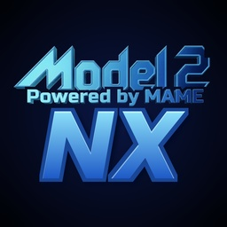

<p align="center"></p>

# Model2 NX

**Sega Model 2 arcade emulator for Nintendo Switch** (homebrew `.nro`), by **ToniiSound**.

Built on [MAME](https://www.mamedev.org)'s Model 2 driver, with MAME's SDL front end
and the Switch platform layer from [SuperModel NX](https://github.com/toniisound/supermodel-nx).

> **Version 1.0.** The games boot and play on a real Switch, but most of them are
> still well below full speed: Daytona USA runs at about a third of its real speed
> at stock clocks. See [Performance](#performance) and the [roadmap](docs/roadmap.md).

> No ROMs are included: provide your own, and only use copies of games you own.
> Not affiliated with or endorsed by Sega or Nintendo. Sega, Model 2 and the game
> titles are trademarks of their respective owners.

## Features

- Every game in MAME's Model 2 driver (Daytona USA, Virtua Fighter 2, Sega Rally
  Championship, Virtua Cop, Dead or Alive, Sega Touring Car Championship and more).
- MAME's game list and menus, with Joy-Cons or the Pro Controller (Nintendo layout).
- Settings and NVRAM are saved, also when the software is closed from the HOME menu.
- Model 2's geometry processing runs on its own CPU core.

## Installing

1. Copy `model2nx.nro` to `sdmc:/switch/model2nx/` on the SD card.
2. Put your ROMs, as MAME-style zips, in `sdmc:/switch/model2nx/roms/`
   (for example `daytona.zip`, `vf2.zip`). They must match the MAME version in
   `mame/` (0.289).
3. Start it from the Homebrew Menu with **title override** (hold R while starting a
   game): MAME needs the memory the album applet does not have.

On first launch it creates its folders and installs `mame.ini`, `ui.ini` and
`ini/source/model2.ini` in `sdmc:/switch/model2nx/`. Edit them there; they are never
overwritten. Delete one to get the defaults back.

## Controls

| Button | Action |
| --- | --- |
| **−** | Coin |
| **+** | Start (also selects in the games' test menus) |
| **R3** | Test button: opens the game's own test / service menu |
| **L + R** | MAME's menu (input settings, dip switches, ...) |
| **− and +** together | Back to the game list |

Games linked to other cabinets (Daytona USA's *LINK ID: MASTER* screen): in the test
menu, set *Game Assignments → Link ID* to **SINGLE** once; it is kept in the NVRAM.

## Performance

`model2nx.log` in `sdmc:/switch/model2nx/` reports, every few seconds, the emulated
frames per second and how much time each emulated CPU and each part of the frame
take. In Daytona USA, at stock clocks:

| Part | Share of the time |
| --- | --- |
| TGP (geometry DSP, interpreted) | 22 % |
| i960 (main CPU, interpreted) | 21 % |
| 68000 (sound) | 14 % |
| Z80 (I/O and drive boards) | 11 % |
| Drawing | 9 % |

Overclocking the CPU with sys-clk (1785 MHz) helps a lot. The next big step is a
recompiler for the i960 and the TGP; see the [roadmap](docs/roadmap.md).

## Building (WSL or Linux with devkitPro)

```sh
sudo dkp-pacman -S switch-dev switch-sdl2 switch-mesa switch-zlib
make -j2
```

Output: `build/switch/model2nx.nro`. The first build compiles about 1,100 files of
MAME and takes a while; keep `-j` low (2) if WSL runs out of memory
(`Killed signal terminated program cc1plus`).

| Option | Effect |
| --- | --- |
| `NXLINK=1` | Sends console output to the PC (`nxlink -s build/switch/model2nx.nro`) |
| `DEBUG=1` | `-O1 -g` |
| `V=1` | Shows the compiler command lines |
| `PLATFORM=linux` | PC build (`build/linux/model2nx`), for testing; needs SDL2 |

`make frontend` builds only the front end and platform layer, a quick check of the
Switch-specific code before the full build.

## How it is put together

| Folder | Contents |
| --- | --- |
| `mame/` | The part of MAME the Model 2 driver needs, imported by `scripts/import_mame.py`. Every change for the Switch is marked `Model 2 NX`. |
| `mame.mk` | Source lists, defines and include paths of each MAME library (generated). |
| `switch/` | Switch platform layer (from SuperModel NX) and the log file. |
| `osd/nx/` | Switch versions of MAME's OS-dependent files (memory, sockets, web server, missing modules). |
| `config/switch/` | `mame.ini`, `ui.ini` and `ini/source/model2.ini`, bundled in the `.nro`. |
| `assets/` | The icon (`assets/source/` has the 1024×1024 master). |
| `docs/` | [Roadmap](docs/roadmap.md) and [updating MAME](docs/updating-mame.md). |

## Credits

- **Model2 NX**: Nintendo Switch port by ToniiSound.
- **MAME**: © Nicola Salmoria and the MAME team. <https://www.mamedev.org>
  The Model 2 driver and the i960, MB86233/MB86234, SHARC and MB86235 cores are the
  work of the MAME developers.
- **SuperModel NX** (ToniiSound and Thorhax): the Switch platform layer.
- devkitPro and libnx, SDL2, Mesa.

## License

GNU General Public License v3 or later: see [LICENSE](LICENSE).

The files in `mame/` keep their own licenses: MAME's are almost all BSD-3-Clause
(a few MIT, LGPL-2.1-or-later or public domain), and the third-party libraries in
`mame/3rdparty/` have theirs (zlib, MIT, BSD, GPL-2.0-or-later, ...). See the header
of each file and `mame/COPYING`. All of them allow distribution under
GPL-3.0-or-later as part of this program.

## Donations

This emulator is completely free and open-source. Optional donations to support the development are always welcome:

[](https://ko-fi.com/toniisound)
[](https://paypal.me/toniisound)
